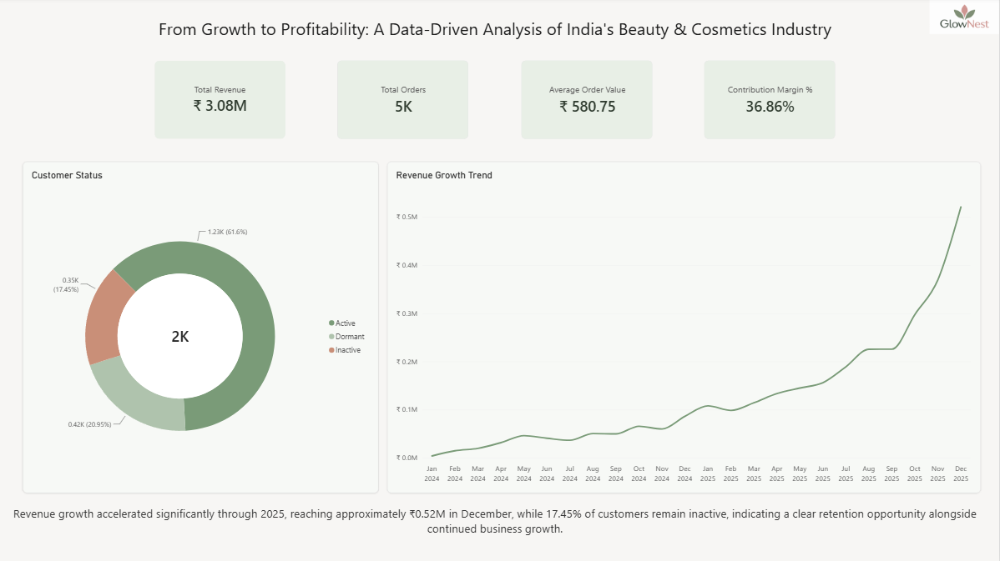
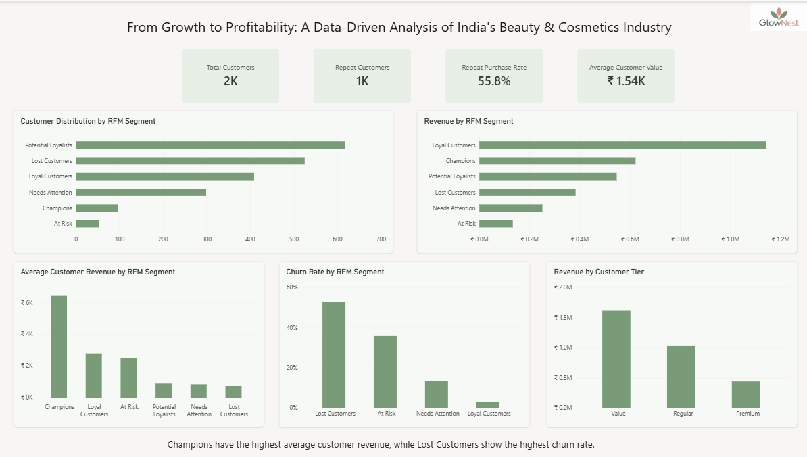
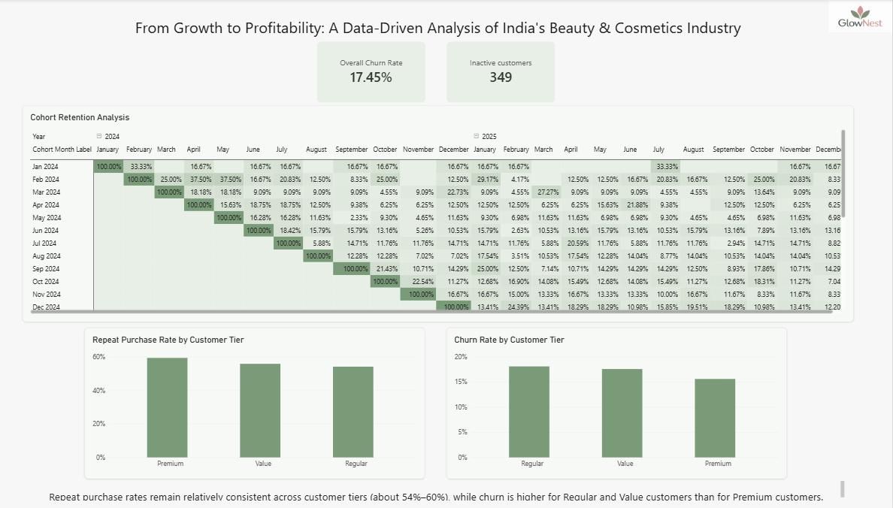
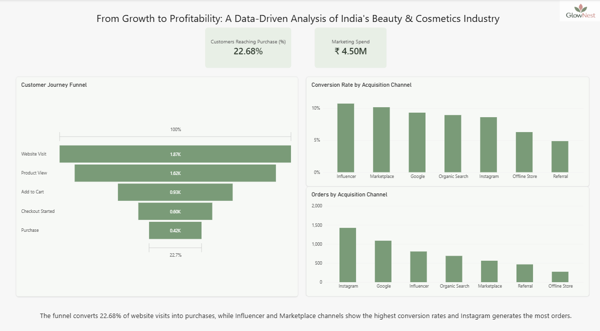
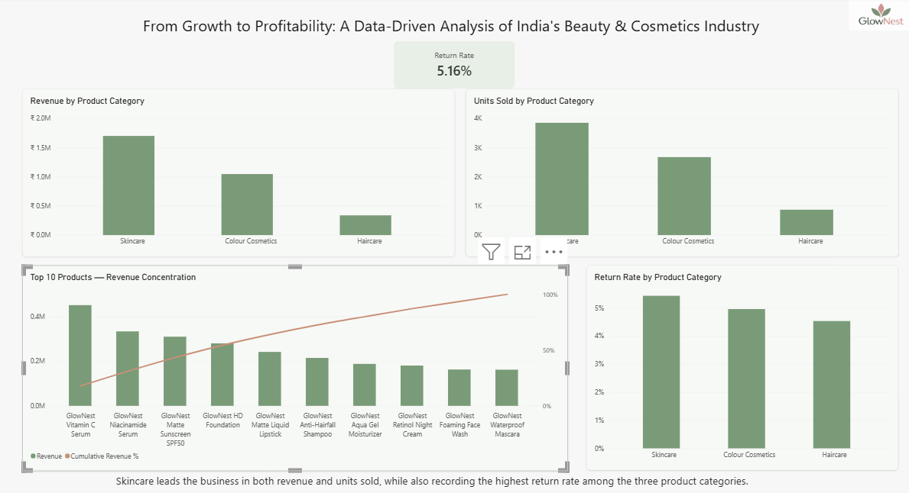

# GlowNest — Customer Analytics: From Growth to Profitability

## Project Overview

**From Growth to Profitability: A Data-Driven Analysis of India's Beauty & Cosmetics Industry**

This portfolio project analyses synthetic data for GlowNest, a fictional direct-to-consumer (D2C) beauty brand. It explores customer behaviour, retention, purchase patterns, product performance, and contribution margin to identify opportunities for sustainable growth.

**Business question:** Why are customers becoming inactive, which customer segments are most valuable, where do customers drop off, and what actions could improve retention and revenue?

GlowNest is a fictional brand. SUGAR Cosmetics provides business-case context only; none of the data represents actual SUGAR Cosmetics customers, transactions, or financial results.

## Business Problem

Revenue growth alone does not guarantee sustainable profitability. A D2C business may experience declining repeat purchases, customer churn, heavy discounting, product returns, and increasing operating costs.

This project examines customer and sales data to understand these challenges and support data-driven decisions.

## Project Objectives

- Analyse customer purchasing behaviour and revenue trends.
- Segment customers using RFM analysis.
- Examine repeat purchasing and customer inactivity.
- Measure monthly cohort retention.
- Analyse the customer purchase funnel.
- Evaluate product, category, and return-rate performance.
- Calculate contribution margin for delivered orders.
- Build interactive dashboards to communicate business insights.

## Dataset

The project uses five relational synthetic datasets covering 2024–2025.

| Table | Rows | Purpose |
|---|---:|---|
| Customers | 2,000 | Customer profiles, status, acquisition, and purchase summaries |
| Orders | 5,315 | Transactions, discounts, order status, and variable costs |
| Products | 20 | Product categories, prices, and cost information |
| Marketing Campaigns | 150 | Campaign spend, reach, conversions, and reported revenue |
| Customer Funnel | 11,157 | Customer journey events |

The datasets were designed for portfolio analysis and do not represent real company data.

## Data Preparation

### Excel and Power Query

- Imported CSV files and checked data quality.
- Corrected data types and date formats.
- Checked missing values and duplicates.
- Reviewed categorical fields.
- Reviewed numeric ranges and potential inconsistencies.
- Prepared datasets for SQL Server.

### SQL Server

The datasets were loaded into the `D2C_Beauty_Analytics` database.

The SQL workflow includes database and table creation, data loading, validation, business analysis, and customer analytics.

## SQL Analysis

The project contains 37 analytical questions across sales, customer, and product performance.

### Sales and Revenue

- Monthly revenue and order trends.
- Revenue by acquisition channel and customer tier.
- Product and category performance.
- Product returns and top customers.

### Customer Analytics

- Customer purchase frequency and monetary value.
- Repeat purchase behaviour.
- Customer inactivity and churn analysis.
- Customer value by acquisition channel.

### RFM Segmentation

- Recency, frequency, and monetary scoring.
- Six customer segments: Champions, Loyal Customers, Potential Loyalists, At Risk, Lost Customers, and Needs Attention.
- Customer counts and revenue by segment.
- Average customer value by segment.

RFM scores use fixed thresholds, with a common reference date of **31 December 2025**.

| Score | Recency (days) | Frequency (orders) | Monetary value (₹) |
|---:|---|---|---:|
| 5 | ≤ 30 | ≥ 8 | ≥ 8,000 |
| 4 | 31–90 | 6–7 | 5,000–7,999.99 |
| 3 | 91–180 | 4–5 | 3,000–4,999.99 |
| 2 | 181–365 | 2–3 | 1,500–2,999.99 |
| 1 | > 365 | 1 or fewer | < 1,500 |

### Cohort and Retention Analysis

- First-purchase cohort assignment.
- Monthly cohort size and activity.
- Customer retention rates.
- Post-acquisition active-customer patterns.

### Purchase and Churn Analysis

- Purchase frequency distribution.
- Repeat-purchase rate and customer distribution by number of orders.
- Churn by purchase frequency.
- Churn by preferred channel and customer tier.

## Power BI Dashboard

The interactive Power BI report contains five pages.

### 1. Executive Overview

- Total revenue and total orders.
- Average order value.
- Contribution margin for delivered orders.
- Customer status distribution.
- Monthly revenue growth.

### 2. Customer Segmentation & Value

- RFM customer distribution.
- Revenue by RFM segment.
- Average customer value.
- Customer and revenue comparisons across segments and tiers.

### 3. Customer Retention & Cohort Analysis

- Customer inactivity and churn indicators.
- Cohort retention analysis.
- Repeat purchase and churn comparisons by customer tier.

### 4. Customer Journey / Funnel Analysis

- Customers reaching purchase.
- Customer journey funnel.
- Conversion rates by acquisition channel.
- Orders by acquisition channel.

The purchase and repeat-purchase analysis is distinct from the full customer journey funnel.

### 5. Product & Sales Performance

- Revenue by product category.
- Units sold by category.
- Return rates by category.
- Top 10 products and revenue concentration (Pareto analysis).

## Dashboard Screenshots

### Executive Overview



### Customer Segmentation & Value



### Customer Retention & Cohort Analysis



### Customer Journey / Funnel Analysis



### Product & Sales Performance



## Key Results

The following figures are based on the current synthetic dataset and report calculations.

| Metric | Result |
|---|---:|
| Customers | 2,000 |
| Orders | 5,315 |
| Units Sold | 7,399 |
| Total Revenue (dashboard) | Approximately ₹3.08M |
| Average Order Value | ₹580.75 |
| Return Rate | 5.16% |
| Repeat Customers | 1,115 |
| Repeat Purchase Rate | 55.75% |
| Inactive Customers | 349 |
| Churn Rate | 17.45% |
| Customers Reaching Purchase | 22.68% |
| Contribution Margin — Delivered Orders | 36.86% |

**Customers Reaching Purchase:** Approximately 423 of 1,865 customers with website-visit events also have a purchase event, according to the funnel analysis. This is a funnel-specific metric and should not be interpreted as a fully reconciled business-wide conversion rate.

### Contribution Margin Calculation

Contribution margin for delivered orders is calculated as:

**Contribution Margin % = Delivered-order contribution profit ÷ Delivered-order revenue × 100**

Contribution profit is calculated after deducting product cost of goods sold (COGS), shipping costs, marketplace commission, and fulfilment costs from delivered-order revenue. Cancelled and returned orders are excluded from this calculation.

## Selected Analytical Observations

- Monthly revenue increases through 2025, reaching approximately ₹0.52M in December 2025.
- Skincare is the largest category in the synthetic dataset, generating approximately ₹1.70M in revenue.
- Champions account for 97 of 2,000 customers (approximately 4.9%) and generate approximately ₹0.62M, or about 20% of customer-level revenue.
- The Top 10 products account for approximately 82% of total product revenue, indicating revenue concentration among leading products.
- RFM segmentation distinguishes high-value customers from customers who may need re-engagement.
- Cohort analysis helps evaluate how customer activity changes after acquisition.
- Purchase-funnel analysis helps identify potential drop-off points.
- Product and category return rates highlight areas for further investigation.

These observations describe the simulated dataset and should not be interpreted as findings about an actual business. Revenue-concentration percentages should be interpreted using the relevant table and calculation scope.

## Business Implications

### Retention

Use customer status and purchase history to identify opportunities for customer reactivation and repeat purchasing.

### Customer Segmentation

Use RFM segments to tailor retention and engagement strategies to different customer groups.

### Funnel Optimisation

Investigate the stages where customers drop off and identify opportunities to improve conversion.

### Product Performance

Use category revenue, units sold, and return rates to prioritise further product-level investigation.

### Profitability

Use delivered-order contribution margin to understand revenue remaining after the specified variable costs.

## Known Limitations

- All datasets are synthetic and do not represent actual company data.
- Marketing campaign data has not been reconciled with customer and order records. Therefore, Customer Acquisition Cost (CAC) and Return on Ad Spend (ROAS) are not reported.
- Churn analysis uses the customer status labels available in the dataset.
- Customer-level revenue and order-level revenue may differ because they are calculated from different tables and may use different aggregation logic.
- Potential duplicate order records with different order IDs have been flagged for verification. The original dataset has been retained unchanged; the records have not been independently confirmed as duplicates.
- The 22.68% funnel metric represents customers reaching purchase as defined by the report. It should not be interpreted as a fully validated end-to-end conversion rate without reconciling funnel events to customer and order records.
- Contribution margin is calculated for delivered orders only; it is not a complete measure of company profitability.

## Tools and Technologies

- Excel
- Power Query
- SQL Server / T-SQL
- Power BI
- DAX
- Relational data modelling
- Data cleaning and validation
- RFM segmentation
- Cohort and retention analysis
- Funnel analysis
- Pareto analysis

## Project Structure

```text
GlowNest-Customer-Analytics/
├── README.md
├── Data/
│   └── Clean_Dataset/
│       ├── customers.csv
│       ├── orders.csv
│       ├── products.csv
│       ├── marketing_campaign.csv
│       └── customer_funnel.csv
├── PowerBI/
│   └── GlowNest_Consumer_Analytics.pbix
├── Screenshots/
│   ├── 01_Executive_Overview.png
│   ├── 02_Customer_Segmentation.png
│   ├── 03_Customer_Retention_Cohort.png
│   ├── 04_Customer_Journey_Funnel.png
│   └── 05_Product_Sales_Performance.png
└── SQL/
    ├── 01_create_database.sql
    ├── 02_create_tables.sql
    ├── 03_data_loading.sql
    ├── 04_data_validation.sql
    ├── 05_business_analysis.sql
    └── 06_customer_analytics.sql
```

## What This Project Demonstrates

This project demonstrates an end-to-end analytics workflow:

**Raw Data → Data Cleaning → Data Validation → SQL Database → SQL Analysis → Customer Analytics → Power BI Data Modelling → Interactive Dashboards → Business Insights**

It showcases the use of Excel, SQL Server, and Power BI to transform synthetic business data into customer and sales insights.

## Disclaimer

This is a portfolio project using synthetic data. All customer records, transactions, campaign results, and financial figures are simulated for analytical demonstration and should not be treated as actual company data.
